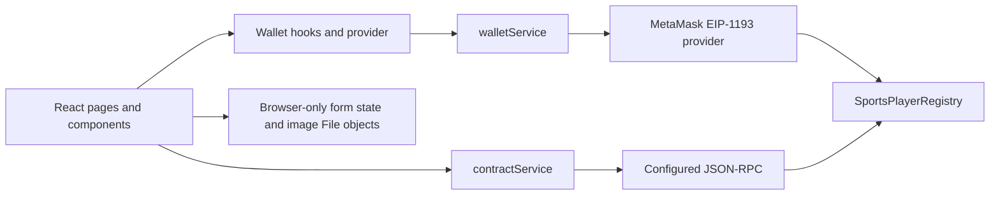

# Architecture

## Phase 1 Flow

The app uses React Router routes for the landing page, participant registration, and organizer dashboard. `WalletProvider` reads the selected account and chain, checks the organizer role on the configured network, and listens for account and chain changes. Pages access this state through `useWallet()`.

The frontend configuration in `src/config/network.js` selects Sepolia (`11155111`) or Localhost (`31337`) using `VITE_TARGET_CHAIN`. `src/config/contract.json` contains one most-recent deployment record and `SportsPlayerRegistry.abi.json` supplies the interface. The service checks that the deployment chain ID matches the selected target.

The pages do not import ethers. `services/blockchain/contractService.js` owns contract creation, provider selection, reads, writes, and normalization of integer return values. `walletService.js` owns MetaMask connection, chain switching, and event subscriptions. `errorMapper.js` maps provider and contract errors to displayable messages. `utils/participant.js` uses ethers utilities for bytes32 generation and commitment encoding outside the page components.

Read calls use a JSON-RPC provider when the selected network has a configured RPC URL; otherwise the service can use the browser wallet provider. Writes use a MetaMask signer unless a signer is explicitly supplied by a local Node check. Public event reads do not require organizer permission. Organizer event listing filters events by the connected organizer address. Single event reads use the Solidity/ABI method `getEventById(eventId)`.

## Data Boundaries

### Currently On-Chain

- Event ID, name, organizer wallet, creation timestamp, registration deadline, and registration-open flag.
- Per-event synthetic participant reference (`bytes32`), commitment (`bytes32`), registrant wallet, submission timestamp, and registration enum value.
- Contract events, transaction data, and all resulting metadata are public and persistent on the selected chain.

### Currently Browser-Only

The registration form holds the participant's name, date of birth, gender, affiliation values, and selected image `File` objects in React/browser memory. The form submits only the event ID, participant reference, and commitment to the contract. The personal fields and images are not saved to the current backend (there is none) and are lost on refresh. The participant reference, salt, and commitment are shown in the transaction receipt; the participant must retain the relevant receipt values for later checks.

### Future Off-Chain Boundary

An eventual Express API and MongoDB service may store authorized participant records and metadata. Protected document storage would need to be designed separately from database metadata. An off-chain record could link to a registration using the event ID and participant reference and retain the corresponding commitment/transaction reference. On lookup, the system would recompute `keccak256(abi.encode(eventId, participantId, salt))` or compare the stored commitment, according to an approved privacy and access policy. Personal data must not be copied into public contract inputs or event names.

The commitment only binds the submitted event ID, participant reference, and salt. It neither encrypts off-chain details nor proves their truthfulness. A matching commitment or registration is not identity verification; an organizer must compare the participant to the presented identity document in person.

## Decisions Future Phases Must Preserve

- Keep contract reads and writes behind the blockchain service layer. Pages and visual components must not import ethers or construct contracts.
- Use the centralized network and deployment config; do not scatter contract addresses or chain IDs through the UI.
- Use the actual single-event Solidity getter `getEventById(eventId)`; keep it distinct from ethers v6 built-in method names.
- Preserve the commitment encoding exactly: `keccak256(abi.encode(uint256 eventId, bytes32 participantId, bytes32 salt))`. Changing ABI types or packed-vs-standard encoding breaks verification compatibility.
- Keep personal details and images out of contract calldata, logs, event names, and participant references.
- Keep registration existence, commitment matching, and real-world identity verification as three separate concepts and statuses.
- Do not treat a client-side role display as authorization. Contract role checks remain authoritative for organizer writes.
- Plan around public, permanent chain data and potentially guessable commitments. Use high-entropy participant references and salts.